 

  

  

   

 

  

---

## 🎯 Áreas de atuação

<table align="center">
  <tr>
    <td align="center" width="25%">
      <h3>🔌 Hardware</h3>
      UART, JTAG, firmware, análise de dispositivos IoT
    </td>
    <td align="center" width="25%">
      <h3>🚗 Automotivo</h3>
      Car Hacking e segurança de sistemas embarcados
    </td>
    <td align="center" width="25%">
      <h3>🛠️ Maker</h3>
      Arduino, ESP32, Raspberry Pi e NFC
    </td>
    <td align="center" width="25%">
      <h3>🕵️ Pentest</h3>
      Web, mobile e hardware
    </td>
  </tr>
</table>

---

## 🧰 Arsenal

**Ofensivo & Cloud**

`Metasploit` · `Burp Suite` · `Nmap` · `OWASP`

 

**Desenvolvimento**

---

## 🛤️ Trajetória

| 💻 **KaBuM!** | ➜ | 🛡️ **Accenture** | ➜ | ✈️ **Próximo capítulo** |
|:---:|:---:|:---:|:---:|:---:|
| Full Stack Developer Perl, Python, AngularJS, TypeScript, Next.js, NestJS Secure Coding Practices | | Cybersecurity Specialist Pentest & Ethical Hacking Secure Development Lifecycle | | Alemanha Levar a expertise para o cenário internacional |

---

## 🎤 No palco

---

## 🏅 Certificações & Plataformas

<table align="center">
  <tr>
    <td align="center" width="220">
      
        
      <b>Google Cybersecurity Professional</b>
    </td>
    <td align="center" width="220">
      
        
      <b>Google Network Security</b>
    </td>
    <td align="center" width="220">
      
        
      <b>Reinvention with Agentic AI (Accenture)</b>
    </td>
  </tr>
</table>

 

 

---

## 🎮 Fora do terminal

<table align="center">
  <tr>
    <td align="center" width="25%"><h3>🥋 Corpo</h3>Academia Kung Fu</td>
    <td align="center" width="25%"><h3>🌊 Mar</h3>Surfe Longboard Praia</td>
    <td align="center" width="25%"><h3>🔓 Lockpicking</h3>Abrir fechaduras sem a chave (com autorização, claro)</td>
    <td align="center" width="25%"><h3>🛠️ Bancada</h3>Soldar Prototipar Impressão 3D</td>
  </tr>
  <tr>
    <td align="center" width="25%"><h3>🎥 Conteúdo</h3>YouTube Instagram Palestras</td>
    <td align="center" width="25%"><h3>📚 Mente</h3>Ler livros Estudar o próximo desafio</td>
    <td align="center" width="25%"><h3>🎮 Games</h3>LoL PS5</td>
    <td align="center" width="25%"><h3>🐾 Zephyr</h3>Cão de assistência (autismo) Adestramento com propósito</td>
  </tr>
</table>

---

## 📊 Stats

 

---

### 📫 Bora trocar uma ideia sobre tech ou segurança?

📧 [contato@strongreen.com](mailto:contato@strongreen.com) &nbsp;|&nbsp; 🌐 [www.strongreen.com](https://www.strongreen.com)

